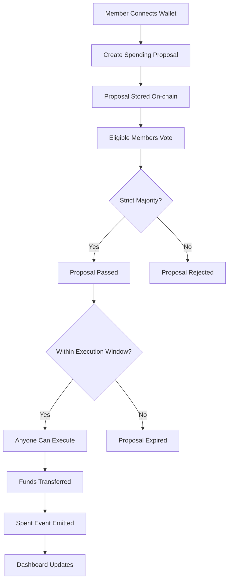
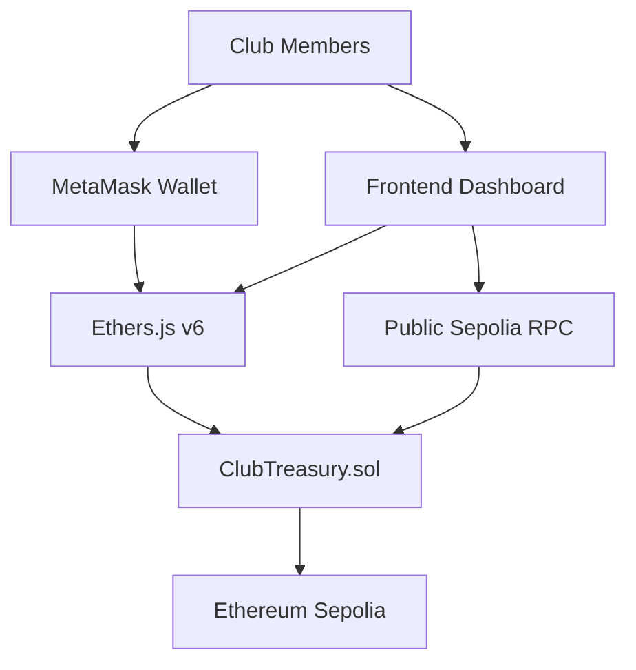

# 🏛️ Club Treasury
### VibeChain × MERAZ 7.0 | Round 1

<p align="center">
  <strong>A decentralized treasury. Collective decisions. Complete transparency.</strong>
</p>

<p align="center">
  
  
  
  
</p>

<p align="center">
  <a href="YOUR_VERCEL_URL">🚀 Live Demo</a> •
  <a href="YOUR_CONTRACT_ADDRESS">📜 Smart Contract</a> •
  <a href="docs/DESIGN.md">🛡️ Design & Threat Model</a>
</p>

---

## 🌐 The Vision

**What if club funds were controlled by everyone, instead of just one person?**

Traditional club treasuries depend on a few individuals managing money through personal bank accounts, UPI transactions, and private group conversations.

This creates a lack of transparency, accountability, and trust.

**Club Treasury changes that.**

We built a decentralized treasury where members collectively control club funds through on-chain voting. Every proposal, approval, and payment is recorded on Ethereum Sepolia.

No administrator. No privileged deployer. No hidden authority.

Just transparent, community-driven financial governance.

---

## ✨ Experience the Platform

### 🖥️ Dashboard & Treasury Overview

A centralized view of the club's financial activities, governance status, and treasury health.

**Key dashboard experiences:**
- Live treasury balance.
- Total contributions and member count.
- Active, passed, rejected, and executed proposals.
- Recent treasury transactions.
- Public read-only access without connecting a wallet.

### 🗳️ Democratic Governance

Members can create spending proposals with a recipient, amount, and purpose.

Other eligible members can vote YES or NO.

A proposal passes only when more than 50% of the members in its creation-time snapshot vote YES.

### 💸 Transparent Transactions

Every successful payment is associated with its approved proposal.

Members and external observers can independently verify the transaction through the blockchain.

### 🔐 Wallet Integration

MetaMask connects members to the treasury.

- Connect wallet to participate.
- View membership eligibility.
- Create proposals.
- Vote on active proposals.
- Execute approved transactions.
- Read-only mode for visitors.

---

## 🎨 UI/UX Design Philosophy

We designed the interface around three principles:

| Principle | User experience |
|---|---|
| Clarity | Important financial information is visible immediately. |
| Simplicity | Voting and proposal creation require minimal steps. |
| Transparency | Every important action has a verifiable on-chain record. |

**Suggested visual direction:**

- Dark navy / charcoal background.
- Electric blue and violet accents.
- Emerald for approved transactions.
- Red for rejected proposals.
- Clean typography and generous spacing.
- Responsive dashboard for desktop and mobile.
- Interactive proposal cards with clear status indicators.
- Confirmation dialogs before financial transactions.

The interface should feel like a modern Web3 financial dashboard rather than a traditional banking application.

---

## ⚙️ How the System Works



### The governance lifecycle

| Status | Meaning |
|---|---|
| 🟡 Active | Voting is in progress. |
| 🟢 Passed | Required majority has approved. |
| 🔵 Executed | Payment successfully completed. |
| 🔴 Rejected | Proposal failed to receive the required approval. |
| ⚪ Expired | Voting or execution deadline passed. |
| ⚫ Cancelled | Proposal was cancelled under contract rules. |

---

## 🏗️ Architecture



### Technology Stack

| Layer | Technology |
|---|---|
| Blockchain | Ethereum Sepolia |
| Smart Contract | Solidity |
| Security | OpenZeppelin ReentrancyGuard |
| Wallet | MetaMask |
| Web3 Integration | Ethers.js v6 |
| Frontend | HTML, CSS, JavaScript |
| Testing | Hardhat |
| Development | Antigravity |
| Deployment | Sepolia + Vercel |

---

## 🔒 Security & Governance Rules

Security is built into the smart contract rather than depending on trust in an administrator.

| Rule | Enforcement |
|---|---|
| Minimum membership | At least 3 members. |
| Equal voting | One eligible member, one vote. |
| Strict majority | YES votes must exceed 50% of the proposal snapshot. |
| Voting snapshot | Membership is fixed for each proposal's voting threshold. |
| Spending limit | Default maximum 50% of treasury balance. |
| Execution protection | Approved amount is fixed and execution is one-time. |
| Reentrancy protection | OpenZeppelin ReentrancyGuard. |
| Execution deadline | Passed proposals expire after the 2-day grace period. |
| No privileged deployer | No owner or administrator role. |

**Important:** The contract does not guarantee protection against every possible collusion or economic attack. Review `docs/DESIGN.md` for the threat model and limitations.

---

## 🧪 Testing & Validation

Our test suite covers normal operations and adversarial scenarios.

- [x] Contribution and balance tracking.
- [x] Proposal creation.
- [x] Voting eligibility.
- [x] Majority validation.
- [x] Membership changes.
- [x] Minimum membership enforcement.
- [x] Spending cap enforcement.
- [x] Insufficient balance protection.
- [x] Duplicate execution prevention.
- [x] Reentrancy attack protection.
- [x] Expired and rejected proposal protection.

---

## 🚀 Run Locally

### 1. Clone the repository

```bash
git clone YOUR_GITHUB_REPOSITORY_URL
cd club-treasury
```

### 2. Install dependencies

```bash
npm install
```

### 3. Configure environment

```bash
cp .env.example .env
```

Configure your throwaway Sepolia deployment wallet and at least three founder addresses in `.env`.

Never commit private keys or secret credentials.

### 4. Run tests

```bash
npm test
```

### 5. Deploy to Sepolia

```bash
npm run deploy:sepolia
```

This deploys the contract and updates the frontend configuration and deployment metadata.

### 6. Start the frontend

```bash
npm run serve
```

Open:

```text
http://localhost:5173
```

### 7. Deploy the frontend

```bash
cd frontend
npx vercel --prod
```

Update and commit `frontend/config.js` with the deployed contract address before publishing.

---

## 📂 Project Structure

```text
club-treasury/
│
├── contracts/
│   ├── ClubTreasury.sol
│   └── mocks/
│
├── frontend/
│   ├── index.html
│   ├── style.css
│   ├── app.js
│   └── config.js
│
├── test/
│   └── ClubTreasury.test.js
│
├── docs/
│   └── DESIGN.md
│
├── .env.example
├── hardhat.config.js
├── package.json
└── README.md
```

---

## 🔗 Deployment Information

| Detail | Information |
|---|---|
| Blockchain | Ethereum Sepolia |
| Contract | `YOUR_DEPLOYED_CONTRACT_ADDRESS` |
| Explorer | [View on Sepolia Etherscan](YOUR_ETHERSCAN_URL) |
| Frontend | [Launch Live Dashboard](YOUR_VERCEL_URL) |
| Development | Antigravity |

*Deployment links will be updated after successful deployment.*

---

## 🎬 Demo Scenario

Want to understand how the treasury works?

Try this three-member governance demonstration:

1. Connect three founder wallets.
2. Create a spending proposal from Wallet A.
3. Wallets B and C vote YES.
4. Observe the proposal reach the Passed state.
5. Execute the proposal using any account.
6. Verify the transaction on Sepolia Etherscan.
7. Open the dashboard without connecting a wallet and inspect the transaction history.

**The important part:** The deployer is not required to approve, authorize, or execute the payment.

---

## 🌍 Why It Matters

Club Treasury is more than a smart contract that stores ETH.

It demonstrates how blockchain can improve the way communities manage shared resources.

- **Trust through code:** Rules are enforced automatically.
- **Democracy through voting:** Financial decisions belong to members.
- **Transparency through blockchain:** Every payment is publicly verifiable.
- **Accountability through records:** Every spending decision has a purpose and an approval history.

Our goal is simple:

**Make collective money management transparent, democratic, and accessible.**

---

<p align="center">
  <strong>🏛️ Club Treasury</strong>
  <br/>
  Built for VibeChain × MERAZ 7.0
  <br/>
  <em>Community-owned. Blockchain-powered. Transparently governed.</em>
</p>
